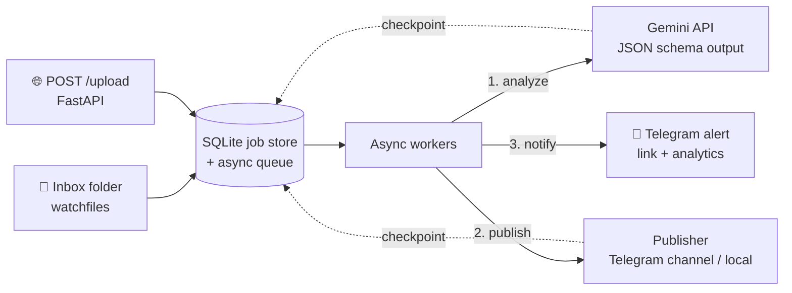

# 🤖 Autonomous Multi-Platform Content & Analytics Agent


An event-driven, fault-tolerant agent pipeline. **Drop a file in a folder (or upload it via API) →
Gemini analyzes it and returns structured JSON metadata → the post is published → you get a live
alert with the link and analytics on your phone via Telegram.**

Built with **Python 3.12 · FastAPI · asyncio · Gemini API (structured outputs) · Telegram Bot API · SQLite · Docker**.

## Architecture



Each job is a **checkpointed state machine**:

```
QUEUED ──analyze──▶ ANALYZED ──publish──▶ PUBLISHED ──notify+archive──▶ DONE
   └────────────── on error: keep checkpoint, back off, retry ───────────────▶ FAILED (after N tries)
```

## Engineering highlights

| Concern | How it's handled |
|---|---|
| **Async orchestration** | `asyncio` workers, async Gemini client (`client.aio`), async HTTP (`httpx`), async folder watching (`watchfiles`) |
| **Structured LLM output** | Pydantic `ContentMetadata` passed as Gemini `response_schema`, so the response is validated JSON, never free text |
| **Rate limits** | Client-side sliding-window `RateLimiter` (RPM) + concurrency semaphore; 429/5xx → exponential backoff with jitter; honors Telegram's `retry_after` |
| **Crash / pause safety** | Every stage is saved to SQLite (WAL) *before* advancing. On restart, unfinished jobs resume from their last checkpoint, so completed LLM calls are never repeated |
| **Idempotency** | Files are deduplicated by SHA-256, so dropping the same file twice won't reprocess or double-post |
| **Large media** | Images and small media are sent inline; large video/audio goes through the Gemini Files API |
| **Observability** | Per-job analytics (tokens, latency, word count, end-to-end time), JSON output per job, REST status API, phone alerts on success *and* failure |
| **Extensibility** | `Publisher` protocol: add YouTube / X / LinkedIn by implementing one `publish()` method |
| **Deployment** | Dockerfile (non-root, healthcheck), docker-compose with persistent volume, GitHub Actions CI |

## Quick start

### 1. Run locally (works with zero API keys, in offline demo mode)
```bash
git clone https://github.com/YOUR_USERNAME/content-agent.git
cd content-agent
python -m venv .venv && source .venv/bin/activate      # Windows: .venv\Scripts\activate
pip install -r requirements-dev.txt
cp .env.example .env
uvicorn app.main:app --reload
```
Drop `samples/why_async_python.md` into `data/inbox/` and watch the logs. Open http://localhost:8000/docs for the interactive API.

### 2. Add Gemini
Get a key at https://aistudio.google.com/apikey and set `GEMINI_API_KEY` in `.env`.
Default model: `gemini-2.5-flash` (fast and cheap). Use `gemini-2.5-pro` for the best quality.

### 3. Add Telegram alerts to your phone
1. In Telegram, message **@BotFather** → `/newbot` → copy the token into `TELEGRAM_BOT_TOKEN`.
2. Send any message to your new bot, then open
   `https://api.telegram.org/bot<TOKEN>/getUpdates` and copy `"chat":{"id": ...}` into `TELEGRAM_ALERT_CHAT_ID`.
3. *(Optional, for real publishing)* Create a public channel, add the bot as **admin**, set
   `TELEGRAM_CHANNEL_ID=@your_channel` and `PUBLISHER=telegram_channel`.

### 4. Run with Docker
```bash
docker compose up --build -d
docker compose logs -f
```
On Windows/macOS set `WATCH_FORCE_POLLING=true` so folder watching works through the volume.

## API

| Method | Endpoint | Description |
|---|---|---|
| `POST` | `/upload` | Upload a file (multipart `file`) → creates a job |
| `GET` | `/jobs?status=DONE` | List jobs |
| `GET` | `/jobs/{id}` | Job details: metadata, publish link, analytics, errors |
| `POST` | `/jobs/{id}/retry` | Retry a FAILED job from its furthest completed stage |
| `GET` | `/health` | Status, queue size, active model |

```bash
curl -F "file=@photo.jpg" http://localhost:8000/upload
```

Supported: text (`.txt .md .csv .json .html`), images (`.jpg .png .webp .gif`), video (`.mp4 .mov .webm .mkv`), audio (`.mp3 .wav .m4a .ogg`).

## Where things are saved
```
data/
├── jobs.db        # the source of truth: every job and checkpoint
├── inbox/         # drop files here
├── uploads/       # files received via API
├── outputs/       # <job_id>.json, the full result of every job (human-readable)
├── published/     # posts written by the local publisher
└── processed/     # source files archived after DONE
```

## Tests
```bash
pytest -v
```
Covers retry/backoff, rate limiting, the happy path, deduplication, **resume-after-restart without
re-calling the LLM**, transient-failure recovery, and permanent failure plus manual retry.

## Project structure
```
app/
├── main.py        # FastAPI app + lifespan (starts workers & watcher)
├── pipeline.py    # checkpointed state machine, retries, alerts
├── llm.py         # Gemini structured output (+ offline MockAnalyzer)
├── publisher.py   # Publisher protocol, Local + Telegram channel publishers
├── telegram.py    # Telegram API client with 429 handling, phone notifier
├── db.py          # SQLite job store
├── watcher.py     # async inbox watcher
├── media.py       # type detection, hashing, content stats
├── retry.py       # backoff + rate limiter
├── models.py      # Pydantic schemas & job states
└── config.py      # settings from .env
```

## Known limitation (and how it's mitigated)
If the process dies in the instant *after* a platform accepts a post but *before* the checkpoint is
written, that post could be published twice on resume. The window is milliseconds, and the
checkpoint is written immediately after the API returns. A production fix would use platform-side
idempotency keys where available.

## Roadmap ideas
- YouTube Data API / X API publishers (OAuth2)
- Scheduled publishing (`publish_at` column + scheduler)
- Pull real engagement stats back into analytics after 24h
- Web dashboard for jobs
